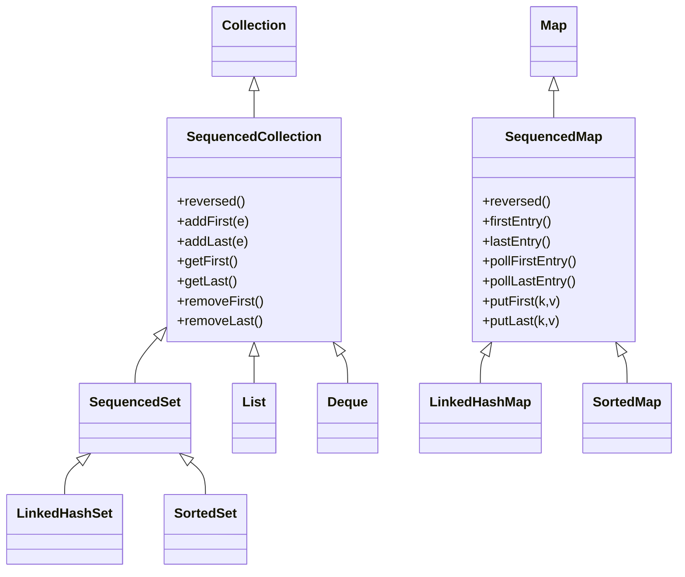
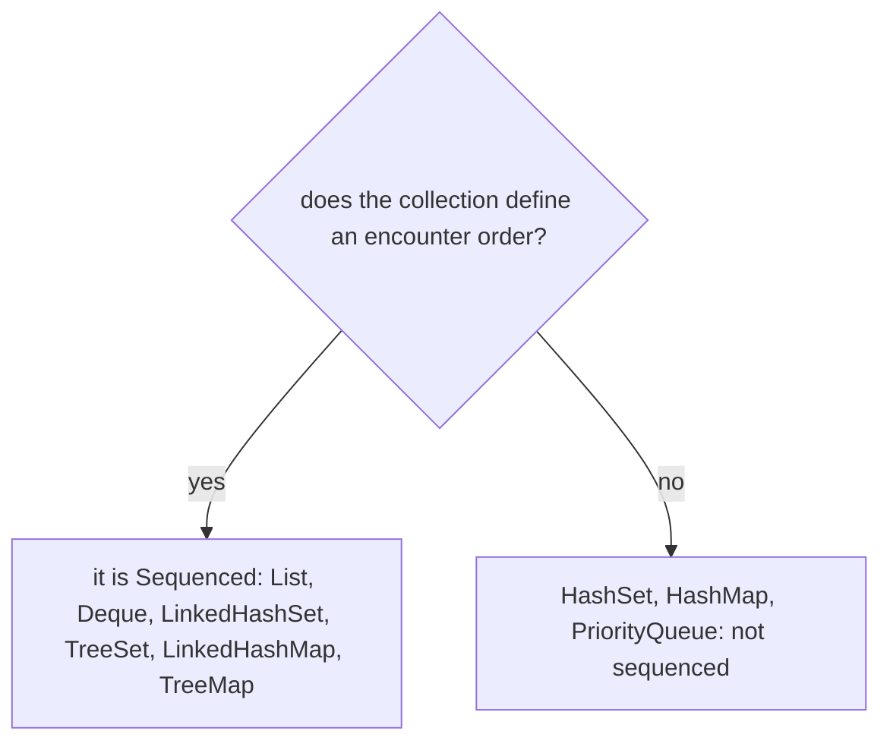

# 7.2 Sequenced Collections

> **Goal:** Use the three new interfaces (`SequencedCollection`, `SequencedSet`, `SequencedMap`) to get "first", "last" and "reversed" on any ordered collection without hand-written workarounds, and know which classes do and do not have them.

**Level:** everyday API. Added in **Java 21** (JEP 431) and retrofitted onto existing collection classes.
**Verified on:** OpenJDK 21.0.12. Outputs are real.

## Contents

1. [The gap this fills](#1-the-gap-this-fills)
2. [The new interfaces](#2-the-new-interfaces)
3. [Lists and deques](#3-lists-and-deques)
4. [Sets: `LinkedHashSet` and `TreeSet`](#4-sets-linkedhashset-and-treeset)
5. [Maps: `SequencedMap`](#5-maps-sequencedmap)
6. [Which classes have it](#6-which-classes-have-it)
7. [`reversed()` is a view](#7-reversed-is-a-view)
8. [Immutability and failure modes](#8-immutability-and-failure-modes)
9. [Common gotchas](#9-common-gotchas)
10. [Interview questions](#10-interview-questions)

---

## 1. The gap this fills

Every ordered collection had a first and a last element, but each class spelled the question differently:

| Want | `List` | `Deque` | `LinkedHashSet` | `SortedSet` | `LinkedHashMap` |
|---|---|---|---|---|---|
| first | `list.get(0)` | `getFirst()` | `iterator().next()` | `first()` | `entrySet().iterator().next()` |
| last | `list.get(list.size()-1)` | `getLast()` | *loop to the end* | `last()` | *loop to the end* |
| reverse iteration | `ListIterator` | `descendingIterator()` | *copy and reverse* | `descendingSet()` | *copy and reverse* |

There was no common type to write a method like "print the last element" for all of them. Java 21 adds one.

> **Analogy.** A queue at a counter, a row of books, a train: all have a front and a back. Until 21 each class invented its own words for "the front", and some (`LinkedHashSet`) had none.

## 2. The new interfaces



```text
 Collection
   +-- SequencedCollection  (first/last/reversed)
         +-- List, Deque
         +-- SequencedSet   (no duplicates)
               +-- LinkedHashSet, SortedSet (TreeSet)
 Map
   +-- SequencedMap         (first/last entries, reversed)
         +-- LinkedHashMap, SortedMap (TreeMap)
```

`SequencedCollection` has **seven** methods: `reversed`, `addFirst`, `addLast`, `getFirst`, `getLast`, `removeFirst`, `removeLast`. The `get`/`remove` pair throws `NoSuchElementException` on an empty collection.

## 3. Lists and deques

The complete demo for the whole chapter:

```java
import java.util.*;

public class Sequenced {
    public static void main(String[] args) {
        // 1. List now has first/last accessors and reversed()
        List<String> list = new ArrayList<>(List.of("b", "c", "d"));
        list.addFirst("a");
        list.addLast("e");
        System.out.println(list + " first=" + list.getFirst() + " last=" + list.getLast());
        System.out.println("removeFirst=" + list.removeFirst() + ", removeLast=" + list.removeLast() + " -> " + list);

        // 2. reversed() is a VIEW, not a copy
        List<String> rev = list.reversed();
        System.out.println("reversed view: " + rev);
        list.add("z");
        System.out.println("after adding to the original: " + rev + "   (view sees it)");
        rev.addFirst("Y");                                    // writes through to the END of the original
        System.out.println("addFirst on the view -> original: " + list);

        // 3. LinkedHashSet: sequenced, with encounter order
        SequencedSet<Integer> lhs = new LinkedHashSet<>(List.of(3, 1, 2));
        System.out.println("LinkedHashSet " + lhs + " first=" + lhs.getFirst() + " last=" + lhs.getLast() + " reversed=" + lhs.reversed());
        lhs.addFirst(2);                                      // moves an existing element to the front
        System.out.println("addFirst(2) repositions: " + lhs);

        // 4. TreeSet is a SequencedSet too (sorted order is its encounter order); positional adds are rejected
        SequencedSet<Integer> ts = new TreeSet<>(List.of(5, 1, 3));
        System.out.println("TreeSet first=" + ts.getFirst() + " last=" + ts.getLast() + " reversed=" + ts.reversed());
        try { ts.addFirst(0); } catch (UnsupportedOperationException e) { System.out.println("TreeSet.addFirst: UnsupportedOperationException"); }

        // 5. Deque is a SequencedCollection
        Deque<String> dq = new ArrayDeque<>(List.of("x", "y", "z"));
        System.out.println("Deque reversed: " + dq.reversed() + " getFirst=" + dq.getFirst());

        // 6. SequencedMap: LinkedHashMap and TreeMap
        SequencedMap<String, Integer> map = new LinkedHashMap<>();
        map.put("one", 1); map.put("two", 2); map.put("three", 3);
        System.out.println(map + " firstEntry=" + map.firstEntry() + " lastEntry=" + map.lastEntry());
        map.putFirst("zero", 0);
        map.putLast("one", 11);                               // re-put moves the key to the end
        System.out.println("after putFirst/putLast: " + map);
        System.out.println("reversed map: " + map.reversed());
        System.out.println("pollFirstEntry=" + map.pollFirstEntry() + ", sequencedKeySet=" + map.sequencedKeySet() + ", sequencedValues=" + map.sequencedValues());

        // 7. immutable and unordered collections are NOT sequenced
        System.out.println("List.of is a SequencedCollection: " + (List.of(1) instanceof SequencedCollection<?>));
        System.out.println("HashSet is a SequencedCollection: " + (new HashSet<>() instanceof SequencedCollection<?>));
        System.out.println("HashMap is a SequencedMap: " + (new HashMap<>() instanceof SequencedMap<?, ?>));
        try { List.of(1, 2).addFirst(0); } catch (UnsupportedOperationException e) { System.out.println("List.of(...).addFirst: UnsupportedOperationException"); }
        try { new ArrayList<>().getFirst(); } catch (NoSuchElementException e) { System.out.println("empty getFirst: NoSuchElementException"); }

        // 8. unmodifiable sequenced wrappers
        SequencedCollection<String> ro = Collections.unmodifiableSequencedCollection(list);
        try { ro.addFirst("n"); } catch (UnsupportedOperationException e) { System.out.println("unmodifiableSequencedCollection.addFirst: UnsupportedOperationException"); }

        // 9. the old way, for comparison
        List<String> old = new ArrayList<>(List.of("p", "q", "r"));
        String last = old.get(old.size() - 1);                 // Java 8-20: last element
        System.out.println("old last element idiom: " + last + " vs getLast(): " + old.getLast());
    }
}

// ---- Output ----
// [a, b, c, d, e] first=a last=e
// removeFirst=a, removeLast=e -> [b, c, d]
// reversed view: [d, c, b]
// after adding to the original: [z, d, c, b]   (view sees it)
// addFirst on the view -> original: [b, c, d, z, Y]
// LinkedHashSet [3, 1, 2] first=3 last=2 reversed=[2, 1, 3]
// addFirst(2) repositions: [2, 3, 1]
// TreeSet first=1 last=5 reversed=[5, 3, 1]
// TreeSet.addFirst: UnsupportedOperationException
// Deque reversed: [z, y, x] getFirst=x
// {one=1, two=2, three=3} firstEntry=one=1 lastEntry=three=3
// after putFirst/putLast: {zero=0, two=2, three=3, one=11}
// reversed map: {one=11, three=3, two=2, zero=0}
// pollFirstEntry=zero=0, sequencedKeySet=[two, three, one], sequencedValues=[2, 3, 11]
// List.of is a SequencedCollection: true
// HashSet is a SequencedCollection: false
// HashMap is a SequencedMap: false
// List.of(...).addFirst: UnsupportedOperationException
// empty getFirst: NoSuchElementException
// unmodifiableSequencedCollection.addFirst: UnsupportedOperationException
// old last element idiom: r vs getLast(): r
```

For lists:

- `getFirst()` and `getLast()` replace `get(0)` and `get(size()-1)`. On an **empty** list they throw `NoSuchElementException` (the `empty getFirst` line of the output), instead of the confusing `IndexOutOfBoundsException` from `get(-1)`.
- `removeFirst()` and `removeLast()` shorten the list; `addFirst` inserts at index 0.
- `reversed()` returns a **reverse-ordered view** (section 7).
- `old last element idiom: r vs getLast(): r` shows the two forms give the same result.

For `Deque` (which already had these names), the new interface just makes it part of the common type: `Deque reversed: [z, y, x] getFirst=x`.

## 4. Sets: `LinkedHashSet` and `TreeSet`

`LinkedHashSet` keeps insertion order. Before 21 you could not get its last element without iterating.

- `first=3 last=2 reversed=[2, 1, 3]` shows the new reads.
- `addFirst(2)` on a set that already contains `2` **moves** it to the front: `[2, 3, 1]`. For sets, adding an existing element at a given end repositions it. (An ordinary `add` of an existing element is still a no-op.)
- `TreeSet` is sorted by its comparator, so you cannot choose a position: `addFirst` and `addLast` throw `UnsupportedOperationException`. `first()`, `last()` and `reversed()` work and `reversed()` gives the same as `descendingSet()`.

## 5. Maps: `SequencedMap`

`LinkedHashMap` and `TreeMap` gain first/last entry access and positional put:

- `firstEntry()` and `lastEntry()` return an immutable snapshot entry, or `null` if empty (note: different from collections, which throw).
- `pollFirstEntry()` and `pollLastEntry()` remove and return it.
- `putFirst(k, v)` and `putLast(k, v)` insert at an end; if the key exists, it is moved there and the value updated (the demo shows `one` moved to the end with value `11`).
- `sequencedKeySet()`, `sequencedValues()` and `sequencedEntrySet()` are views that are themselves sequenced.
- `reversed()` is a view of the map in reverse order.

| Operation | `LinkedHashMap` | `TreeMap` |
|---|---|---|
| `firstEntry` / `lastEntry` | yes | yes (was already there) |
| `putFirst` / `putLast` | yes | `UnsupportedOperationException` |
| `reversed()` | yes | same as `descendingMap()` |

## 6. Which classes have it

| Class | Sequenced? | Why |
|---|---|---|
| `ArrayList`, `LinkedList`, `List.of(...)` | yes | have an encounter order |
| `ArrayDeque`, `LinkedList` | yes | `Deque` is sequenced |
| `LinkedHashSet` | yes | insertion order |
| `TreeSet`, `ConcurrentSkipListSet` | yes | sorted order |
| `LinkedHashMap`, `TreeMap` | yes | ordered map |
| `HashSet`, `HashMap` | **no** | no defined order |
| `PriorityQueue` | **no** | only the head is defined |

The program prints `HashSet is a SequencedCollection: false` and `HashMap is a SequencedMap: false`, and `List.of is a SequencedCollection: true` (immutable lists have an order; they simply refuse the mutating methods).



## 7. `reversed()` is a view

`reversed()` does not copy. It returns a window onto the same data in the opposite order:

- After adding `z` to the original list the reversed view showed it (`view sees it`).
- `addFirst` **on the view** wrote to the *end* of the original list.

That is cheap (O(1) to create) but it means: do not mutate the source while iterating the view, and copy (`new ArrayList<>(list.reversed())`) if you need a snapshot.

```text
 original:   [ b  c  d  z ]  ----> addLast goes here
 reversed(): [ z  d  c  b ]
                ^
   addFirst on the view lands at the end of the original
```

## 8. Immutability and failure modes

| Case | Behaviour |
|---|---|
| `List.of(...).addFirst(x)` | `UnsupportedOperationException` |
| `Collections.unmodifiableSequencedCollection(c)` | read methods work, writes throw |
| `getFirst()` on empty | `NoSuchElementException` |
| `TreeSet.addFirst` | `UnsupportedOperationException` |
| `firstEntry()` on empty map | `null`, no exception |

Also new in `Collections`: `unmodifiableSequencedSet` and `unmodifiableSequencedMap`, plus `newSequencedSetFromMap`.

## 9. Common gotchas

| Gotcha | Fix |
|---|---|
| Assuming `HashSet`/`HashMap` have `getFirst` | not sequenced; pick `LinkedHashSet` / `LinkedHashMap` |
| `reversed()` treated as a copy | it is a live view; copy if you need a snapshot |
| `addFirst` on a `TreeSet` | sorted collections choose the position themselves |
| Custom `List` implementation breaks | the new methods are **default** methods; your class may inherit surprising behaviour, test it |
| Method clash in your own subclass named `reversed()` or `getFirst()` | return type or semantics may conflict after upgrading to 21 |
| `firstEntry()` returns `null` | check, unlike `getFirst()` on collections |

## 10. Interview questions

<details>
<summary><strong>Q1. What problem do sequenced collections solve?</strong></summary>

There was no common way to get the first/last element or reverse an ordered collection; each class used different methods and some had none. The new interfaces give one API.
</details>

<details>
<summary><strong>Q2. Which interfaces were added?</strong></summary>

<code>SequencedCollection</code>, <code>SequencedSet</code> and <code>SequencedMap</code>.
</details>

<details>
<summary><strong>Q3. Is <code>HashSet</code> a <code>SequencedCollection</code>?</strong></summary>

No, it has no defined encounter order. <code>LinkedHashSet</code> and <code>TreeSet</code> are.
</details>

<details>
<summary><strong>Q4. Is <code>reversed()</code> a copy?</strong></summary>

No, it is a live view; changes to the source show through, and writes to the view write to the source.
</details>

<details>
<summary><strong>Q5. What does <code>getFirst()</code> do on an empty list?</strong></summary>

Throws <code>NoSuchElementException</code>.
</details>

<details>
<summary><strong>Q6. What does <code>addFirst</code> do on a <code>LinkedHashSet</code> that already has the element?</strong></summary>

It moves the element to the front.
</details>

<details>
<summary><strong>Q7. Why does <code>TreeSet.addFirst</code> throw?</strong></summary>

Position is determined by the comparator, so a caller cannot choose it: <code>UnsupportedOperationException</code>.
</details>

<details>
<summary><strong>Q8. What do <code>firstEntry()</code> and <code>putFirst()</code> do on a <code>LinkedHashMap</code>?</strong></summary>

<code>firstEntry()</code> returns a snapshot of the first entry (or <code>null</code>). <code>putFirst</code> puts the mapping at the front, moving it if the key already exists.
</details>

<details>
<summary><strong>Q9. Why is <code>List.of(...)</code> sequenced yet <code>addFirst</code> fails?</strong></summary>

It has an order but is immutable; mutators throw <code>UnsupportedOperationException</code>.
</details>

<details>
<summary><strong>Q10. How do you iterate a <code>LinkedHashMap</code> in reverse before and after 21?</strong></summary>

Before 21: copy entries into a list and reverse it. From 21: <code>map.reversed().entrySet()</code> (or <code>sequencedEntrySet().reversed()</code>).
</details>

<details>
<summary><strong>Q11. Name a source-compatibility risk when upgrading to 21.</strong></summary>

A class that already declared its own <code>reversed()</code>, <code>getFirst()</code>, <code>getLast()</code>, <code>addFirst</code> etc. may now conflict with the inherited default method (different return type or meaning).
</details>

---

[Previous: 7.1 Pattern Matching for switch](./01-pattern-matching-switch-and-record-patterns.md) · Next: [7.3 Virtual Threads (Introduction)](./03-virtual-threads-intro.md)