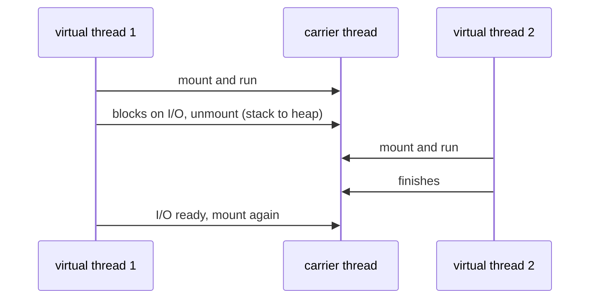
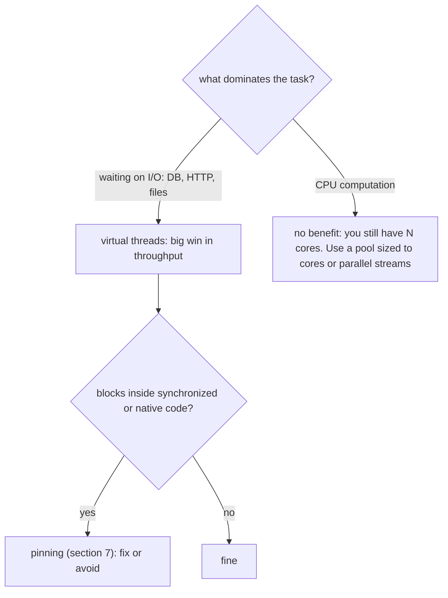

# 7.3 Virtual Threads (Introduction)

> **Goal:** Understand what a virtual thread is, why "one thread per task" becomes cheap again, how to create and limit them, and the handful of rules (no pooling, pinning, thread locals) that decide whether they help you.

**Level:** the most talked-about feature of Java 21 (JEP 444, final in 21; preview in 19 and 20). This chapter is the practical introduction; the memory model and the full concurrency toolbox are in [Part 11](../11-jmm-and-concurrency-core/README.md) and [Part 12](../12-concurrency-advanced/README.md).
**Verified on:** OpenJDK 21.0.12. Outputs are real; the demo avoids timing numbers so the output is stable. Structured concurrency and scoped values are **preview** in 21 and appear only as non-runnable text.

## Contents

1. [The problem: threads are expensive, requests are many](#1-the-problem-threads-are-expensive-requests-are-many)
2. [What a virtual thread is](#2-what-a-virtual-thread-is)
3. [Creating virtual threads](#3-creating-virtual-threads)
4. [Thread-per-task at scale](#4-thread-per-task-at-scale)
5. [Do not pool them: limit with a `Semaphore`](#5-do-not-pool-them-limit-with-a-semaphore)
6. [When they help and when they do not](#6-when-they-help-and-when-they-do-not)
7. [Pinning](#7-pinning)
8. [`ThreadLocal`, interruption and the rest of the thread API](#8-threadlocal-interruption-and-the-rest-of-the-thread-api)
9. [Preview features around them (text only)](#9-preview-features-around-them-text-only)
10. [Common gotchas](#10-common-gotchas)
11. [Interview questions](#11-interview-questions)

---

## 1. The problem: threads are expensive, requests are many

A classic server handles each request on a thread. A **platform thread** is a thin wrapper over an OS thread: it reserves a stack (typically around 1 MB of address space) and the OS schedules it. You can have thousands, not millions.

Most server threads spend nearly all their time **waiting** (database, HTTP call, disk). So engineers wrote asynchronous code (callbacks, reactive pipelines) to avoid blocking threads. That works, but it breaks stack traces, debuggers, `try/catch` and readability.

Virtual threads restore the simple style (*one thread per task, plain blocking code*) without the cost.

> **Analogy.** Platform threads are checkout lanes with a full-time cashier each. Virtual threads are customers: you can have a hundred thousand of them, and a few cashiers (carrier threads) serve whoever is ready. A customer waiting for a price check steps aside and the cashier takes the next one.

## 2. What a virtual thread is

A **virtual thread** is a `java.lang.Thread` managed by the JVM, not the OS. It is mounted on a **carrier thread** (a platform thread from a built-in pool) while running. When it blocks on something the JDK knows about (sleep, `BlockingQueue`, socket read, lock from `java.util.concurrent`), its stack is copied to the heap and the carrier is released to run another virtual thread. When the wait ends it is mounted again, maybe on a different carrier.



```text
 many virtual threads   : V1 V2 V3 V4 V5 V6 ... V100000   (cheap heap objects)
                           \  |  /    |
 few carrier threads    :   C1  C2  C3 ...                (about one per CPU core)
                            |   |   |
 OS threads             :   OS1 OS2 OS3
```

| | Platform thread | Virtual thread |
|---|---|---|
| Managed by | OS | JVM |
| Stack | fixed reserve, native | grows and shrinks on the heap |
| Cost to create | high | very low |
| Practical count | thousands | millions |
| Daemon | configurable | **always daemon** |
| Priority | settable | fixed at normal (5) |
| Pooling | normal | **do not pool** |

It is still a `Thread`: same class, same `Runnable`, same `interrupt()`, same `join()`.

## 3. Creating virtual threads

```java
import java.time.Duration;
import java.util.*;
import java.util.concurrent.*;
import java.util.concurrent.atomic.*;
import java.util.stream.*;

public class VThreads {
    public static void main(String[] args) throws Exception {
        // 1. three ways to start a virtual thread
        Thread t1 = Thread.ofVirtual().name("vt-1").start(() -> System.out.println("hello from " + Thread.currentThread().getName()));
        t1.join();
        Thread t2 = Thread.startVirtualThread(() -> System.out.println("startVirtualThread: isVirtual=" + Thread.currentThread().isVirtual()));
        t2.join();
        Thread t3 = Thread.ofVirtual().unstarted(() -> System.out.println("unstarted then started"));
        System.out.println("state before start: " + t3.getState());
        t3.start();
        t3.join();

        // 2. properties of a virtual thread
        Thread v = Thread.ofVirtual().unstarted(() -> { });
        Thread p = Thread.ofPlatform().name("platform-x").unstarted(() -> { });
        System.out.println("virtual : isVirtual=" + v.isVirtual() + ", daemon=" + v.isDaemon() + ", default name='" + v.getName() + "', priority=" + v.getPriority());
        System.out.println("platform: isVirtual=" + p.isVirtual() + ", daemon=" + p.isDaemon() + ", name='" + p.getName() + "'");

        // 3. the point: 10,000 blocking tasks, one virtual thread each, no pool sizing
        AtomicInteger done = new AtomicInteger();
        long start = System.nanoTime();
        try (ExecutorService ex = Executors.newVirtualThreadPerTaskExecutor()) {
            IntStream.range(0, 10_000).forEach(i -> ex.submit(() -> {
                Thread.sleep(Duration.ofMillis(200));                // blocking call: the carrier thread is released
                done.incrementAndGet();
                return i;
            }));
        }                                                          // close() waits for all tasks (ExecutorService is AutoCloseable since 19)
        long ms = (System.nanoTime() - start) / 1_000_000;
        System.out.println("completed " + done.get() + " tasks; each slept 200 ms; finished in under 5 s: " + (ms < 5_000));
        System.out.println("with a 200-thread pool the same work needs at least " + (10_000 / 200 * 200) + " ms of waiting alone");

        // 4. collecting results with futures
        try (ExecutorService ex = Executors.newVirtualThreadPerTaskExecutor()) {
            List<Future<String>> fs = new ArrayList<>();
            for (String s : List.of("a", "b", "c")) fs.add(ex.submit(() -> s.toUpperCase()));
            List<String> out = new ArrayList<>();
            for (Future<String> f : fs) out.add(f.get());
            System.out.println("results in order: " + out);
        }

        // 5. a thread factory for virtual threads with counted names
        ThreadFactory factory = Thread.ofVirtual().name("worker-", 0).factory();
        Thread w0 = factory.newThread(() -> { });
        Thread w1 = factory.newThread(() -> { });
        System.out.println("factory names: " + w0.getName() + ", " + w1.getName());

        // 6. limiting concurrency: use a Semaphore, not a pool
        Semaphore permits = new Semaphore(3);
        AtomicInteger inFlight = new AtomicInteger(), maxInFlight = new AtomicInteger();
        try (ExecutorService ex = Executors.newVirtualThreadPerTaskExecutor()) {
            for (int i = 0; i < 30; i++) ex.submit(() -> {
                permits.acquire();
                try {
                    int now = inFlight.incrementAndGet();
                    maxInFlight.accumulateAndGet(now, Math::max);
                    Thread.sleep(20);
                    inFlight.decrementAndGet();
                } finally { permits.release(); }
                return null;
            });
        }
        System.out.println("max concurrently inside the guarded section: " + maxInFlight.get() + " (limit 3)");

        // 7. ThreadLocal works, but remember there can be millions of threads
        ThreadLocal<String> tl = ThreadLocal.withInitial(() -> "initial");
        Thread tv = Thread.ofVirtual().start(() -> { tl.set("per-virtual-thread"); System.out.println("ThreadLocal in virtual thread: " + tl.get()); });
        tv.join();
        System.out.println("ThreadLocal in main: " + tl.get());

        // 8. interruption works like platform threads
        Thread sleeper = Thread.ofVirtual().start(() -> {
            try { Thread.sleep(10_000); } catch (InterruptedException e) { System.out.println("interrupted while sleeping: virtual threads are interruptible"); }
        });
        Thread.sleep(50);
        sleeper.interrupt();
        sleeper.join();
    }
}

// ---- Output ----
// hello from vt-1
// startVirtualThread: isVirtual=true
// state before start: NEW
// unstarted then started
// virtual : isVirtual=true, daemon=true, default name='', priority=5
// platform: isVirtual=false, daemon=false, name='platform-x'
// completed 10000 tasks; each slept 200 ms; finished in under 5 s: true
// with a 200-thread pool the same work needs at least 10000 ms of waiting alone
// results in order: [A, B, C]
// factory names: worker-0, worker-1
// max concurrently inside the guarded section: 3 (limit 3)
// ThreadLocal in virtual thread: per-virtual-thread
// ThreadLocal in main: initial
// interrupted while sleeping: virtual threads are interruptible
```

Section by section (the program numbers its sections the same way):

1. Three starters: `Thread.ofVirtual().name(...).start(r)`, the shortcut `Thread.startVirtualThread(r)`, and `unstarted(r)` followed by `start()`. State before start is `NEW`, as always.
2. `isVirtual()` is `true`; a virtual thread is a **daemon** (it will not keep the JVM alive), has the default **empty name** unless you set one, and priority 5. `Thread.ofPlatform()` is the matching builder for platform threads.
3. The 10,000-task run, explained in the next section.
4. The futures return in submission order because we call `get()` in order, not because they finished in order.
5. `Thread.ofVirtual().name("worker-", 0).factory()` produces named threads `worker-0`, `worker-1`: useful for logs.

## 4. Thread-per-task at scale

Section 3 of the demo is the heart of the feature:

```java
try (ExecutorService ex = Executors.newVirtualThreadPerTaskExecutor()) {
    IntStream.range(0, 10_000).forEach(i -> ex.submit(() -> {
        Thread.sleep(Duration.ofMillis(200));
        done.incrementAndGet();
        return i;
    }));
}   // close() waits for the tasks
```

All 10,000 tasks completed and the whole thing finished in under five seconds even though each one sleeps 200 ms. A fixed pool of 200 platform threads would need at least `10,000 / 200 * 200 ms = 10,000 ms` of waiting alone (the program prints that formula's result). The virtual-thread executor does **not** pool: it starts one new virtual thread per submitted task.

Notes:

- `ExecutorService` has been `AutoCloseable` since 19. `close()` stops accepting tasks and waits for submitted ones, so try-with-resources is the correct shape.
- `Thread.sleep(Duration)` is also new in 19.
- The only limit is memory, not pool size.

## 5. Do not pool them: limit with a `Semaphore`

A thread pool exists to limit the number of expensive threads. Virtual threads are cheap, so you create one per task and instead limit the **resource** that is scarce (database connections, a rate-limited API):

```java
Semaphore permits = new Semaphore(3);
permits.acquire();
try { ...call the scarce service... } finally { permits.release(); }
```

Section 6 of the demo submitted 30 tasks and counted the highest number inside the guarded section: **3**, exactly the limit.

| Need | Platform-thread habit | Virtual-thread habit |
|---|---|---|
| Max 20 parallel DB calls | pool of 20 threads | `Semaphore(20)` or the DB connection pool itself |
| Reuse threads for speed | thread pool | not needed, creation is cheap |
| Queue excess tasks | pool's work queue | all tasks run as virtual threads, the semaphore queues them |

## 6. When they help and when they do not



Virtual threads improve **throughput** (tasks per second under load) for blocking workloads. They do not make a single request faster, and they do not add CPU capacity.

| Workload | Virtual threads? |
|---|---|
| Web request handler calling several services | yes |
| Batch job doing HTTP calls in parallel | yes |
| Image resizing, hashing, compression | no, CPU-bound |
| Code holding a big lock for long | no, contention remains |

## 7. Pinning

A virtual thread is **pinned** when it cannot unmount while blocked, so it holds its carrier thread hostage. In Java 21 this happens when it blocks:

- inside a `synchronized` block or method, or
- inside a native method or a foreign call.

Pinning is not an error; the program stays correct. But if many virtual threads block while pinned, you lose the scalability benefit and can exhaust the few carriers.

| Cause | Mitigation in 21 |
|---|---|
| Blocking while holding a monitor (`synchronized`) | use `ReentrantLock` for code that blocks inside the critical section |
| Old library with `synchronized` around I/O | upgrade the library, or limit with a semaphore |
| Native/JNI wait | avoid on hot paths |

Detect it with `-Djdk.tracePinnedThreads=full` (prints a stack trace when a virtual thread blocks while pinned) or the JFR event `jdk.VirtualThreadPinned`. Later releases reduce the `synchronized` case (see [Part 8](../08-lts-java-25/README.md)); treat the table above as the rule on 21.

## 8. `ThreadLocal`, interruption and the rest of the thread API

Virtual threads support `ThreadLocal`, `InheritableThreadLocal`, interruption and `join`:

- Sections 7 and 8 of the demo show a `ThreadLocal` set inside a virtual thread (`per-virtual-thread`) invisible in `main` (`initial`), and `interrupt()` waking a sleeping virtual thread with `InterruptedException`.
- The danger is **scale**: if you cache a heavy object (for example a `SimpleDateFormat` or a 1 MB buffer) in a `ThreadLocal`, a million virtual threads create a million copies. Prefer passing values explicitly, using a pool of the heavy object, or scoped values (section 9).
- `Thread.getId()` is deprecated; use `threadId()`.
- `Thread.getAllStackTraces()` and the usual thread dump do not list all virtual threads; use `jcmd <pid> Thread.dump_to_file -format=json file`.

## 9. Preview features around them (text only)

These are **preview in Java 21**: they need `--enable-preview` and their API can change before they are final (see [Part 8](../08-lts-java-25/README.md) for what shipped later). They are shown as non-runnable text.

```text
// Structured concurrency (preview in 21): subtasks live and die with their scope
try (var scope = new StructuredTaskScope.ShutdownOnFailure()) {
    Subtask<User>  user  = scope.fork(() -> findUser(id));
    Subtask<Order> order = scope.fork(() -> findOrder(id));
    scope.join().throwIfFailed();              // wait for both, fail fast on error
    return new Response(user.get(), order.get());
}

// Scoped values (preview in 21): immutable, bounded alternative to ThreadLocal
static final ScopedValue<String> USER = ScopedValue.newInstance();
ScopedValue.where(USER, "alice").run(() -> handle());   // USER.get() valid only inside
```

## 10. Common gotchas

| Gotcha | Why | Fix |
|---|---|---|
| Putting virtual threads in a fixed pool | defeats the purpose, and `newFixedThreadPool` makes platform threads | `newVirtualThreadPerTaskExecutor()`, limit with a `Semaphore` |
| Expecting CPU-bound speed-ups | cores are still limited | use a pool sized to cores |
| `synchronized` around blocking calls | pinning in 21 | `ReentrantLock` |
| Large objects in `ThreadLocal` | one copy per virtual thread | pass explicitly or use `ScopedValue` (preview) |
| Relying on thread names or priorities | name is empty, priority fixed | set names via builder, never rely on priority |
| Forgetting to close the executor | tasks may still run, JVM can exit early (they are daemons) | try-with-resources |
| Unbounded task creation | memory, downstream overload | semaphore or rate limiter |
| Assuming logs show the thread | default name is empty | name threads with the builder |

## 11. Interview questions

<details>
<summary><strong>Q1. What is a virtual thread?</strong></summary>

A lightweight <code>Thread</code> scheduled by the JVM onto a small pool of carrier (platform) threads. When it blocks on a supported operation it unmounts, freeing the carrier.
</details>

<details>
<summary><strong>Q2. How is it different from a platform thread?</strong></summary>

Platform threads map one-to-one to OS threads and are expensive; virtual threads are JVM-managed, cheap, always daemon, have a fixed priority and are meant to be created per task and never pooled.
</details>

<details>
<summary><strong>Q3. Do virtual threads make CPU-bound code faster?</strong></summary>

No. They help throughput of blocking, I/O-bound work. CPU-bound work is limited by cores.
</details>

<details>
<summary><strong>Q4. Why should you not pool virtual threads?</strong></summary>

Pools exist to limit costly threads. Virtual threads are cheap; pooling adds contention and hides the benefit. Limit the scarce resource with a <code>Semaphore</code> or similar.
</details>

<details>
<summary><strong>Q5. What is pinning?</strong></summary>

A virtual thread blocking while it cannot unmount, so it keeps its carrier thread. In 21 it happens inside <code>synchronized</code> blocks and native calls.
</details>

<details>
<summary><strong>Q6. How do you detect pinning?</strong></summary>

<code>-Djdk.tracePinnedThreads=full</code> or the JFR event <code>jdk.VirtualThreadPinned</code>.
</details>

<details>
<summary><strong>Q7. How do you create a virtual thread?</strong></summary>

<code>Thread.ofVirtual().start(r)</code>, <code>Thread.startVirtualThread(r)</code>, or an executor from <code>Executors.newVirtualThreadPerTaskExecutor()</code>.
</details>

<details>
<summary><strong>Q8. Is a virtual thread a daemon thread?</strong></summary>

Always. It does not keep the JVM alive, so wait for it (<code>join</code>, or close the executor).
</details>

<details>
<summary><strong>Q9. Does <code>ThreadLocal</code> work with virtual threads?</strong></summary>

Yes, but each virtual thread has its own copy, so with huge thread counts large thread-locals waste memory.
</details>

<details>
<summary><strong>Q10. What does <code>ExecutorService.close()</code> do (19+)?</strong></summary>

Stops accepting tasks and waits for submitted tasks to finish, so try-with-resources can manage an executor.
</details>

<details>
<summary><strong>Q11. How do you cap concurrent calls to a database when using one virtual thread per task?</strong></summary>

Use a <code>Semaphore</code> (or the connection pool's own limit) around the call.
</details>

<details>
<summary><strong>Q12. What are structured concurrency and scoped values, and what is their status in 21?</strong></summary>

Structured concurrency (<code>StructuredTaskScope</code>) treats related subtasks as one unit; scoped values are immutable, bounded alternatives to thread locals. Both are preview in 21.
</details>

---

[Previous: 7.2 Sequenced Collections](./02-sequenced-collections.md) · Next: [7.4 API Additions 18 to 21](./04-api-additions-18-21.md)