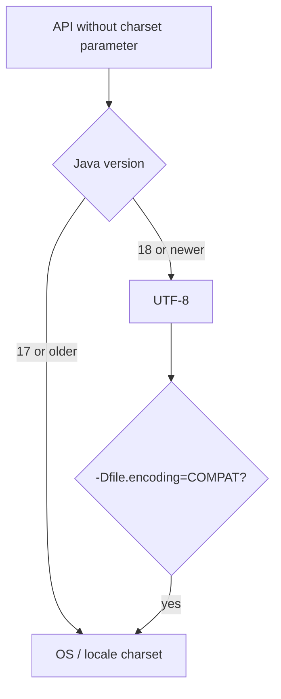

# 7.4 API Additions 18 to 21

> **Goal:** Know the library changes between Java 17 and 21 well enough to use them naturally and to explain the one with the biggest blast radius: UTF-8 as the default charset.

**Level:** everyday API plus one behaviour change that can break file handling.
**Verified on:** OpenJDK 21.0.12. Outputs are real. The sequenced collections (21) and virtual threads (21) have their own chapters; pattern matching is in 7.1.

## Contents

1. [UTF-8 by default (JEP 400, Java 18)](#1-utf-8-by-default-jep-400-java-18)
2. [The demo for the rest of the chapter](#2-the-demo-for-the-rest-of-the-chapter)
3. [Strings and text](#3-strings-and-text)
4. [Numbers and math](#4-numbers-and-math)
5. [Concurrency API](#5-concurrency-api)
6. [Smaller conveniences](#6-smaller-conveniences)
7. [Locale data change (CLDR 42, Java 20)](#7-locale-data-change-cldr-42-java-20)
8. [Tools and documentation](#8-tools-and-documentation)
9. [Feature index](#9-feature-index)
10. [Common gotchas](#10-common-gotchas)
11. [Interview questions](#11-interview-questions)

---

## 1. UTF-8 by default (JEP 400, Java 18)

Until 17 the "default charset" came from the operating system. On a Windows box configured for Windows-1252, `new FileReader("x.txt")` and `new String(bytes)` decoded as 1252; on a Linux server with `LANG=C` they decoded as ASCII. The same code gave different results on different machines.

Since **Java 18** the default charset used by the JDK APIs that *take no charset argument* is **UTF-8** on every platform.

```text
 before 18:  FileReader("a.txt")    --> OS charset (cp1252, ASCII, UTF-8 ...)  depends on the machine
 from 18  :  FileReader("a.txt")    --> UTF-8                                 same everywhere
```

The first lines of the demo in the next section show it: `defaultCharset = UTF-8`. Running the same program with `-Dfile.encoding=COMPAT` (the escape hatch that restores the old behaviour) on a Linux machine whose locale is plain `C` (what a minimal container or `LANG=C` server has) gave:

```text
$ LC_ALL=C ./run.sh s/p7/Api18to21.java -Dfile.encoding=COMPAT 2>&1 | head -1
defaultCharset = US-ASCII
```

What did **not** change:

| Thing | Behaviour |
|---|---|
| `System.out` / `System.in` encoding | still follow the terminal/native encoding (`native.encoding`, `stdout.encoding`) |
| `Charset.defaultCharset()` | now UTF-8 |
| Properties files read by `ResourceBundle` | UTF-8 already since 9 |
| Source files | `javac -encoding` still applies; default also UTF-8 |

Practical advice: **always pass the charset explicitly** (`Files.readString(path, UTF_8)`, `new FileReader(f, UTF_8)`) so code does not depend on the JVM at all. JEP 400 mostly removes surprises for code that did not.



## 2. The demo for the rest of the chapter

```java
import java.nio.charset.Charset;
import java.time.*;
import java.time.format.*;
import java.util.*;
import java.util.concurrent.*;

public class Api18to21 {
    @SuppressWarnings("deprecation")
    public static void main(String[] args) throws Exception {
        // 1. UTF-8 by default (JEP 400, Java 18)
        System.out.println("defaultCharset = " + Charset.defaultCharset());
        System.out.println("native.encoding property present: " + (System.getProperty("native.encoding") != null));

        // 2. Math.clamp (21)
        System.out.println("clamp(15, 0, 10) = " + Math.clamp(15, 0, 10));
        System.out.println("clamp(-3L, 0, 10) = " + Math.clamp(-3L, 0, 10));
        System.out.println("clamp(0.5, 0.0, 1.0) = " + Math.clamp(0.5, 0.0, 1.0));

        // 3. StringBuilder.repeat (21)
        StringBuilder sb = new StringBuilder("[");
        sb.repeat("ab", 3).repeat('-', 4).append("]");
        System.out.println("StringBuilder.repeat -> " + sb);

        // 4. String.indexOf with range (21)
        String s = "a-b-c-d";
        System.out.println("indexOf('-', 2, 5) = " + s.indexOf('-', 2, 5) + ", indexOf(\"c\", 0, 4) = " + s.indexOf("c", 0, 4));

        // 5. String.splitWithDelimiters (21)
        System.out.println("splitWithDelimiters = " + Arrays.toString("1+2*3".splitWithDelimiters("[+*]", 0)));

        // 6. Character emoji predicates (21)
        int smile = 0x1F600;
        System.out.println("isEmoji(U+1F600) = " + Character.isEmoji(smile) + ", isEmoji('a') = " + Character.isEmoji('a') + ", isEmoji('7') = " + Character.isEmoji('7'));

        // 7. HashMap.newHashMap / HashSet.newHashSet (19)
        Map<String, Integer> m = HashMap.newHashMap(100);
        m.put("k", 1);
        Set<String> hs = HashSet.newHashSet(10);
        hs.add("x");
        System.out.println("newHashMap/newHashSet: " + m + " " + hs);

        // 8. Future.resultNow / state / exceptionNow (19)
        ExecutorService ex = Executors.newSingleThreadExecutor();
        Future<Integer> ok = ex.submit(() -> 42);
        ok.get();
        System.out.println("state=" + ok.state() + ", resultNow=" + ok.resultNow());
        Future<Integer> bad = ex.submit(() -> { throw new IllegalStateException("boom"); });
        try { bad.get(); } catch (ExecutionException e) { /* expected */ }
        System.out.println("state=" + bad.state() + ", exceptionNow=" + bad.exceptionNow());
        CountDownLatch gate = new CountDownLatch(1);
        Future<Integer> pending = ex.submit(() -> { gate.await(); return 1; });
        System.out.println("state=" + pending.state());
        try { pending.resultNow(); } catch (IllegalStateException e) { System.out.println("resultNow on a running task -> IllegalStateException"); }
        gate.countDown();
        ex.close();                                   // AutoCloseable since 19
        System.out.println("ex.isTerminated after close(): " + ex.isTerminated());

        // 9. Thread.threadId() replaces deprecated getId() (19)
        System.out.println("threadId == getId : " + (Thread.currentThread().threadId() == Thread.currentThread().getId()));

        // 10. Locale.of (19) replaces constructors
        System.out.println("Locale.of: " + Locale.of("fr", "CA") + " / " + Locale.of("de").getDisplayLanguage(Locale.ENGLISH));

        // 11. Thread.sleep(Duration) and join(Duration) (19)
        Thread.sleep(Duration.ofMillis(5));
        Thread t = Thread.ofPlatform().start(() -> { });
        System.out.println("join(Duration) returned " + t.join(Duration.ofSeconds(1)));

        // 12. Objects.checkIndex style helpers: List.reversed is in the sequenced chapter; here Collections.shuffle(RandomGenerator)
        List<Integer> nums = new ArrayList<>(List.of(1, 2, 3, 4, 5));
        Collections.shuffle(nums, new Random(42));
        System.out.println("shuffle with seed 42 -> " + nums);

        // 13. CLDR 42 (Java 20): NNBSP before AM/PM in the US time format
        String f = DateTimeFormatter.ofLocalizedTime(FormatStyle.SHORT).withLocale(Locale.US).format(LocalTime.of(15, 30));
        StringBuilder cps = new StringBuilder();
        for (char c : f.toCharArray()) if (c > 127) cps.append(String.format("U+%04X", (int) c));
        System.out.println("US short time = '" + f + "' non-ASCII chars: " + cps);
        System.out.println("equals \"3:30 PM\" with normal space: " + f.equals("3:30 PM"));
    }
}

// ---- Output ----
// defaultCharset = UTF-8
// native.encoding property present: true
// clamp(15, 0, 10) = 10
// clamp(-3L, 0, 10) = 0
// clamp(0.5, 0.0, 1.0) = 0.5
// StringBuilder.repeat -> [ababab----]
// indexOf('-', 2, 5) = 3, indexOf("c", 0, 4) = -1
// splitWithDelimiters = [1, +, 2, *, 3]
// isEmoji(U+1F600) = true, isEmoji('a') = false, isEmoji('7') = true
// newHashMap/newHashSet: {k=1} [x]
// state=SUCCESS, resultNow=42
// state=FAILED, exceptionNow=java.lang.IllegalStateException: boom
// state=RUNNING
// resultNow on a running task -> IllegalStateException
// ex.isTerminated after close(): true
// threadId == getId : true
// Locale.of: fr_CA / German
// join(Duration) returned true
// shuffle with seed 42 -> [2, 3, 4, 5, 1]
// US short time = '3:30 PM' non-ASCII chars: U+202F
// equals "3:30 PM" with normal space: false
```

## 3. Strings and text

| API | Since | What it does | From the demo |
|---|---|---|---|
| `StringBuilder.repeat(CharSequence/int codePoint, int count)` | 21 | append a repeated string or character | `[ababab----]` |
| `String.indexOf(ch, from, to)` and `indexOf(str, from, to)` | 21 | search within a bounded range | `indexOf('-', 2, 5) = 3` and the bounded `indexOf("c", 0, 4) = -1` |
| `String.splitWithDelimiters(regex, limit)` | 21 | like `split`, but the matched delimiters are kept in the result | `[1, +, 2, *, 3]` |
| `Character.isEmoji(int)` and related | 21 | Unicode emoji properties | `isEmoji('7')` is `true` (digits are emoji bases) |

Two points worth noticing: `isEmoji('7')` being `true` is correct per Unicode (the digit is the base of keycap sequences), so do not use it alone to detect "pictures"; and `indexOf("c", 0, 4)` returns `-1` because `c` sits at index 4 and the range end is exclusive.

## 4. Numbers and math

`Math.clamp(value, min, max)` (21) returns `value` limited to the range. Overloads accept `long, int, int` (returns `int`), `long, long, long`, `double, double, double` and `float` forms. In the demo: `clamp(15, 0, 10) = 10`, `clamp(-3L, 0, 10) = 0`, `clamp(0.5, 0.0, 1.0) = 0.5`. It throws `IllegalArgumentException` if `min > max`.

The old idiom `Math.max(min, Math.min(max, v))` is easy to get backwards; `clamp` states the intent.

## 5. Concurrency API

| API | Since | Notes |
|---|---|---|
| `Future.resultNow()`, `exceptionNow()`, `state()` | 19 | inspect a *completed* future without a checked exception; `state()` returns `RUNNING`, `SUCCESS`, `FAILED` or `CANCELLED` |
| `ExecutorService` implements `AutoCloseable` | 19 | `close()` waits for tasks, so use try-with-resources |
| `Thread.threadId()` | 19 | replaces deprecated `getId()` |
| `Thread.sleep(Duration)`, `Thread.join(Duration)` | 19 | the latter returns `boolean` (did the thread end?) |
| `Thread.ofVirtual()`, `Thread.ofPlatform()` builders | 21 | see 7.3 |

In the demo the successful task gave `state=SUCCESS, resultNow=42`, the throwing task `state=FAILED, exceptionNow=...IllegalStateException: boom`, and a task blocked on a latch showed `state=RUNNING`; calling `resultNow()` on it threw `IllegalStateException`. After `ex.close()` the executor reported `isTerminated: true`.

## 6. Smaller conveniences

| API | Since | Replaces | Demo output |
|---|---|---|---|
| `HashMap.newHashMap(n)`, `HashSet.newHashSet(n)` | 19 | `new HashMap<>(n)` where `n` is a *capacity*, not an expected size | `{k=1} [x]` |
| `Locale.of(language, country)` | 19 | deprecated `new Locale(...)` | `fr_CA`, `German` |
| `Collections.shuffle(list, RandomGenerator)` | 21 | `Random` only | seeded `Random(42)` gave `[2, 3, 4, 5, 1]` |
| `Thread.threadId()` | 19 | `getId()` | `threadId == getId : true` |

`newHashMap(100)` means "I will put about 100 entries", sizing the table so no resize happens. `new HashMap<>(100)` is a capacity that, with the 0.75 load factor, resizes after 75 entries: a classic mistake the new factory methods remove.

## 7. Locale data change (CLDR 42, Java 20)

Java 20 updated the locale data to **CLDR 42**. One visible change: in the US format the space before `AM`/`PM` is now a **narrow no-break space (U+202F)**, not a normal space. The last lines of the demo prove it: the formatted `3:30 PM` contains one non-ASCII character `U+202F`, and `equals("3:30 PM")` with an ordinary space is `false`.

```text
 17:  "3:30 PM"   (U+0020 between 30 and PM)
 20+: "3:30 PM"   (U+202F between 30 and PM)   <- looks the same, compares different
```

Where it bites: parsing user-entered text, string comparison in tests, and CSV/PDF output. Fixes: normalise with `.replace(' ', ' ')`, parse with a custom pattern (`"h:mm a"`), or set `-Djava.locale.providers=COMPAT` as a temporary workaround (COMPAT is removed in later releases).

## 8. Tools and documentation

| Tool/feature | Since | Notes |
|---|---|---|
| `jwebserver` and `SimpleFileServer` | 18 | minimal static file server: `jwebserver -p 8000`, or `SimpleFileServer.createFileServer(...)` in code (development and testing only) |
| `{@snippet ...}` in Javadoc | 18 | code examples in documentation taken from real source files or regions, e.g. `{@snippet file="Demo.java" region="x"}` |
| Internet-address resolution SPI | 18 | custom `InetAddressResolver` |

`jwebserver` is for "serve this folder to see the files in a browser", not for production.

## 9. Feature index

| Feature | Version | Status |
|---|---|---|
| UTF-8 default charset | 18 | final |
| Simple web server | 18 | final |
| Javadoc `@snippet` | 18 | final |
| `HashMap.newHashMap` etc. | 19 | final |
| `Future.resultNow/state` | 19 | final |
| `ExecutorService` AutoCloseable | 19 | final |
| Virtual threads | 21 | final |
| Sequenced collections | 21 | final |
| `Math.clamp`, `StringBuilder.repeat`, `splitWithDelimiters`, `Character.isEmoji` | 21 | final |
| String templates, unnamed patterns, structured concurrency, scoped values | 21 | **preview** |

## 10. Common gotchas

| Gotcha | Fix |
|---|---|
| Old files saved in a legacy charset now decode as UTF-8 and show `?`/garbage | pass the real charset explicitly when reading |
| `System.out` still prints wrong characters | it uses the native encoding; set `-Dstdout.encoding=UTF-8` or fix the terminal |
| Tests compare `"3:30 PM"` and fail on 20+ | U+202F; normalise or use an explicit pattern |
| `new HashMap<>(100)` believed to hold 100 without resizing | use `HashMap.newHashMap(100)` |
| `new Locale(...)` warnings | `Locale.of(...)` or `Locale.forLanguageTag` |
| `Thread.getId()` warnings | `threadId()` |
| Calling `resultNow()` on an unfinished future | check `state()` first |
| Forgetting `close()` on executors | try-with-resources |

## 11. Interview questions

<details>
<summary><strong>Q1. What did JEP 400 change?</strong></summary>

The default charset of the JDK APIs became UTF-8 on all platforms from Java 18, instead of the OS/locale charset.
</details>

<details>
<summary><strong>Q2. Does it change what <code>System.out</code> uses?</strong></summary>

No. The console encoding still follows the native/terminal encoding (<code>stdout.encoding</code>).
</details>

<details>
<summary><strong>Q3. How do you restore the old behaviour?</strong></summary>

<code>-Dfile.encoding=COMPAT</code>. Better: pass the charset explicitly in code.
</details>

<details>
<summary><strong>Q4. What does <code>Math.clamp</code> do?</strong></summary>

Limits a value to <code>[min, max]</code>; throws if <code>min &gt; max</code>.
</details>

<details>
<summary><strong>Q5. What is the difference between <code>split</code> and <code>splitWithDelimiters</code>?</strong></summary>

The latter keeps the matched delimiters in the result array.
</details>

<details>
<summary><strong>Q6. What are <code>Future.resultNow()</code> and <code>state()</code> for?</strong></summary>

Reading the outcome of an already-completed future without catching checked exceptions; <code>resultNow</code> throws <code>IllegalStateException</code> if it is not successfully completed.
</details>

<details>
<summary><strong>Q7. Why is <code>ExecutorService</code> now <code>AutoCloseable</code>?</strong></summary>

So try-with-resources can wait for tasks and release threads without remembering <code>shutdown</code> and <code>awaitTermination</code>.
</details>

<details>
<summary><strong>Q8. Why use <code>HashMap.newHashMap(n)</code>?</strong></summary>

<code>n</code> is the expected number of mappings, so the table is sized to avoid resizing; the constructor takes a capacity instead.
</details>

<details>
<summary><strong>Q9. A date-time test that passed on 17 fails on 21 with identical-looking strings. Why?</strong></summary>

CLDR 42 (Java 20) uses U+202F before AM/PM.
</details>

<details>
<summary><strong>Q10. What is <code>jwebserver</code>?</strong></summary>

A minimal static-file HTTP server shipped with the JDK from 18, intended for testing and prototyping.
</details>

<details>
<summary><strong>Q11. What is <code>{@snippet}</code>?</strong></summary>

A Javadoc tag that embeds a code example that can be compiled and checked from a real source file or region.
</details>

---

[Previous: 7.3 Virtual Threads (Introduction)](./03-virtual-threads-intro.md) · Next: [7.5 JVM Changes 18 to 21](./05-jvm-changes-18-21.md)