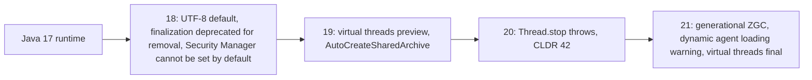

# 7.5 JVM Changes 18 to 21

> **Goal:** Know which JVM behaviours changed between 17 and 21 (default charset, generational ZGC, finalization, security manager, agents, startup archives, removed thread APIs) so that an upgrade is not a surprise.

**Level:** operations and runtime. Read before you change `-XX` flags or upgrade a production service.
**Verified on:** OpenJDK 21.0.12. Outputs are real; flags that need a different JDK or hardware are marked.

## Contents

1. [Overview](#1-overview)
2. [Generational ZGC](#2-generational-zgc)
3. [Which collector am I running?](#3-which-collector-am-i-running)
4. [Finalization is on its way out](#4-finalization-is-on-its-way-out)
5. [The Security Manager can no longer be installed](#5-the-security-manager-can-no-longer-be-installed)
6. [`Thread.stop` and the thread API cleanup](#6-threadstop-and-the-thread-api-cleanup)
7. [Dynamic agent loading warning (JEP 451)](#7-dynamic-agent-loading-warning-jep-451)
8. [Automatic CDS archives (`AutoCreateSharedArchive`)](#8-automatic-cds-archives-autocreatesharedarchive)
9. [Other platform changes](#9-other-platform-changes)
10. [Common gotchas](#10-common-gotchas)
11. [Interview questions](#11-interview-questions)

---

## 1. Overview



| Change | Version | Impact |
|---|---|---|
| UTF-8 default charset | 18 | file I/O without charset (see 7.4) |
| Finalization deprecated for removal; `--finalization=disabled` | 18 | cleanup code, old libraries |
| `System.setSecurityManager` throws by default | 18 | old sandbox code |
| `-XX:+AutoCreateSharedArchive` | 19 | faster start without a manual training step |
| `Thread.stop()` always throws | 20 | old libraries killing threads |
| Generational ZGC (`-XX:+ZGenerational`) | 21 | big reduction in memory and CPU for ZGC users |
| Warning on dynamic agent loading | 21 | Mockito/ByteBuddy-style self-attach |
| `Runtime.exec(String)` deprecated | 18 | use the array or `ProcessBuilder` forms |
| Windows 32-bit x86 port deprecated for removal | 21 | only matters for 32-bit Windows JVMs |

## 2. Generational ZGC

ZGC (low-latency collector, pauses typically well under a millisecond) originally treated the whole heap as one generation. Java 21 adds a **generational** mode, because most objects die young: collecting the young generation often and cheaply spends less CPU and memory than scanning everything each cycle.

```text
 non-generational ZGC:  [ whole heap ........................ ]  every cycle marks all
 generational ZGC     :  [ young ... ][ old ................. ]  young collected often, old rarely
```

- Enable in 21 with `-XX:+UseZGC -XX:+ZGenerational`. In 21 the default for `-XX:+UseZGC` is still **non-generational**; generational became the default in a later release (see [Part 8](../08-lts-java-25/README.md)).
- It is an in-JVM choice: no code changes.
- Goal: lower memory overhead and allocation stalls with the same pause goals.

Whether it helps your service is a measurement question: see [Part 13](../13-gc-and-memory-tuning/README.md).

## 3. Which collector am I running?

The simplest reliable check is the list of garbage-collector MXBeans. The same program, four launches:

```text
$ for f in "-XX:+UseG1GC" "-XX:+UseZGC" "-XX:+UseZGC -XX:+ZGenerational" "-XX:+UseShenandoahGC"; do echo "== java $f"; ./run.sh s/p7/JvmChanges.java $f | head -1; done
== java -XX:+UseG1GC
GC beans: [G1 Concurrent GC, G1 Old Generation, G1 Young Generation]
== java -XX:+UseZGC
GC beans: [ZGC Cycles, ZGC Pauses]
== java -XX:+UseZGC -XX:+ZGenerational
GC beans: [ZGC Major Cycles, ZGC Major Pauses, ZGC Minor Cycles, ZGC Minor Pauses]
== java -XX:+UseShenandoahGC
GC beans: [Shenandoah Cycles, Shenandoah Pauses]
```

Reading it:

- G1 (the default) has three beans.
- Non-generational ZGC shows `ZGC Cycles` and `ZGC Pauses`.
- Generational ZGC shows **Minor** and **Major** cycles and pauses: the signature of two generations.
- Shenandoah is another low-pause collector available in many OpenJDK builds (not in every vendor build).

## 4. Finalization is on its way out

`Object.finalize()` runs cleanup code when the GC reclaims an object. It is unpredictable (no timing guarantee), slows GC, and can resurrect objects. It has been deprecated since 9 and, since **18**, deprecated **for removal**.

```text
$ ./p7/fin.sh
Fin.java:3: warning: [removal] finalize() in Object has been deprecated and marked for removal
    protected void finalize() { System.out.println("finalized"); }
                   ^
1 warning
--- run with finalization disabled
ok
```

- The compiler warns: `[removal] finalize() in Object has been deprecated and marked for removal`.
- `--finalization=disabled` turns the mechanism off at runtime so you can **test whether anything depends on it**. The program ran normally here; `finalized` would only have printed if an object had been collected with finalization on, which this tiny program never triggers.

Use instead:

| Need | Use |
|---|---|
| Release a resource deterministically | `AutoCloseable` + try-with-resources |
| Safety net if `close()` is forgotten | `java.lang.ref.Cleaner` |
| Weak links to objects | `WeakReference`, `PhantomReference` |

## 5. The Security Manager can no longer be installed

The Security Manager (applet-era sandbox) was deprecated for removal in 17. In **18** `System.setSecurityManager` throws `UnsupportedOperationException` unless you start the JVM with `-Djava.security.manager=allow`. The demo's second line shows it:

```text
setSecurityManager -> UnsupportedOperationException
```

Code that merely *calls* `System.getSecurityManager()` still works (it returns `null`). If your application genuinely needs sandboxing, use OS/container isolation, not the JVM.

## 6. `Thread.stop` and the thread API cleanup

`Thread.stop()` was deprecated since 1.2 because it can release locks mid-update and corrupt state. In **20** it simply throws `UnsupportedOperationException` (the demo's third line). `suspend()` and `resume()` are deprecated for removal as well. Use cooperative cancellation: `interrupt()` plus a check of `isInterrupted()`.

```text
 stop() : kills the thread anywhere   -> unsafe, now removed in effect
 interrupt() : sets a flag / wakes a blocking call -> the thread decides when to stop
```

## 7. Dynamic agent loading warning (JEP 451)

Tools such as Mockito (inline mock maker), ByteBuddy, profilers and APMs can attach an **agent** to a running JVM and rewrite classes. From **21** the JVM prints a warning when an agent is loaded dynamically after startup:

```text
WARNING: A Java agent has been loaded dynamically (/path/to/agent.jar)
WARNING: If a serviceability tool is in use, please run with -XX:+EnableDynamicAgentLoading to hide this warning
WARNING: If a serviceability tool is not in use, please run with -Djdk.instrument.traceUsage for more information
WARNING: Dynamic loading of agents will be disallowed by default in a future release
```

(This block is the documented shape of the warning, shown as text because triggering it needs an agent jar.)

| What to do | How |
|---|---|
| Keep the tool, silence the warning | `-XX:+EnableDynamicAgentLoading` |
| Do it the supported way | start the agent at launch: `-javaagent:agent.jar` |
| Tests with Mockito | configure Mockito as a `-javaagent` in the build (Surefire `argLine`) |

A future release will disallow dynamic loading by default, so treat the warning as a to-do item.

## 8. Automatic CDS archives (`AutoCreateSharedArchive`)

**Class Data Sharing** stores pre-parsed JDK/app classes in a file mapped at start-up, cutting start time and memory. Before 19 you needed a training run and `-XX:ArchiveClassesAtExit`. From **19**:

```text
java -XX:+AutoCreateSharedArchive -XX:SharedArchiveFile=app.jsa -jar app.jar
```

If `app.jsa` is missing or stale, the JVM creates it when the program exits; the next start uses it. Real run (the application must be a **jar**; a classes directory is rejected):

```text
$ ./p7/cds.sh
run 1 (no archive yet):
  archive file created: yes
```

The archive was created on the first run. How much faster the next start is depends on your class count; measure with your own application.

| Archive type | Contains | Introduced |
|---|---|---|
| Default (JDK classes) | JDK classes | 12 (on by default) |
| Application (AppCDS) | + your classes | 10 (manual), simplified 13/19 |

## 9. Other platform changes

| Item | Detail |
|---|---|
| `Runtime.exec(String)` deprecated (18) | the single-string form tokenises by whitespace; use `exec(String[])` or `ProcessBuilder` |
| JFR event `jdk.FinalizerStatistics` (18) | lists classes whose instances are still finalized |
| `-XX:+UseSerialGC`/`ParallelGC` unchanged | still selectable |
| Windows 32-bit x86 port deprecated for removal (21) | affects 32-bit Windows builds only |
| Class-file version for Java 21 | 65 (17 was 61) |

## 10. Common gotchas

| Gotcha | Cause | Fix |
|---|---|---|
| App relies on `finalize()` | deprecated for removal | move to `Cleaner`/`close()`; test with `--finalization=disabled` |
| Old library calls `setSecurityManager` | blocked since 18 | upgrade or `-Djava.security.manager=allow` temporarily |
| Library calls `Thread.stop` | throws on 20+ | upgrade the library |
| Dynamic agent warning in test logs | Mockito inline mock maker | configure the agent at startup |
| Switched to `-XX:+UseZGC` and expected generational | not default in 21 | add `-XX:+ZGenerational` |
| CDS archive ignored | classes directory on classpath, or JDK/classpath changed | use a jar; archives are tied to JDK build and classpath |
| Mixed JVM flags from 17 | removed/changed flags make the JVM refuse to start | run once with the new JDK and read the error |

## 11. Interview questions

<details>
<summary><strong>Q1. Why was finalization deprecated for removal?</strong></summary>

It is unpredictable, can delay GC, can resurrect objects and is a source of bugs and security issues. Use try-with-resources and <code>Cleaner</code>.
</details>

<details>
<summary><strong>Q2. What does <code>--finalization=disabled</code> do?</strong></summary>

Disables finalization at runtime so you can verify nothing in your application depends on it.
</details>

<details>
<summary><strong>Q3. What is generational ZGC and how do you enable it in 21?</strong></summary>

ZGC with young and old generations, collecting young objects more often. <code>-XX:+UseZGC -XX:+ZGenerational</code>.
</details>

<details>
<summary><strong>Q4. How can you see from code which collector is active?</strong></summary>

<code>ManagementFactory.getGarbageCollectorMXBeans()</code> names (G1 Young Generation, ZGC Minor Cycles, ...) or <code>-Xlog:gc</code>.
</details>

<details>
<summary><strong>Q5. What happens if you call <code>System.setSecurityManager</code> on 21?</strong></summary>

<code>UnsupportedOperationException</code> unless started with <code>-Djava.security.manager=allow</code>.
</details>

<details>
<summary><strong>Q6. What replaced <code>Thread.stop()</code>?</strong></summary>

Cooperative cancellation using <code>interrupt()</code>; <code>stop()</code> now throws <code>UnsupportedOperationException</code>.
</details>

<details>
<summary><strong>Q7. What is the dynamic agent loading warning about?</strong></summary>

Since 21 loading an agent into a running JVM is warned about, and a future release will disallow it by default. Prefer <code>-javaagent</code> at startup or <code>-XX:+EnableDynamicAgentLoading</code> temporarily.
</details>

<details>
<summary><strong>Q8. What does <code>-XX:+AutoCreateSharedArchive</code> do?</strong></summary>

Creates (or refreshes) a dynamic CDS archive automatically at exit, so subsequent starts load classes from it.
</details>

<details>
<summary><strong>Q9. Why would an archive not be used?</strong></summary>

It does not match the JDK build or classpath, or the classpath has a directory instead of jars.
</details>

<details>
<summary><strong>Q10. Why is <code>Runtime.exec(String)</code> deprecated?</strong></summary>

It splits the command on whitespace, which is error-prone with spaces and quoting; use the array form or <code>ProcessBuilder</code>.
</details>

<details>
<summary><strong>Q11. What is the class-file major version for Java 21?</strong></summary>

65.
</details>

---

[Previous: 7.4 API Additions 18 to 21](./04-api-additions-18-21.md) · Next: [7.6 Migrating from Java 17 to 21](./06-migrating-17-to-21.md)