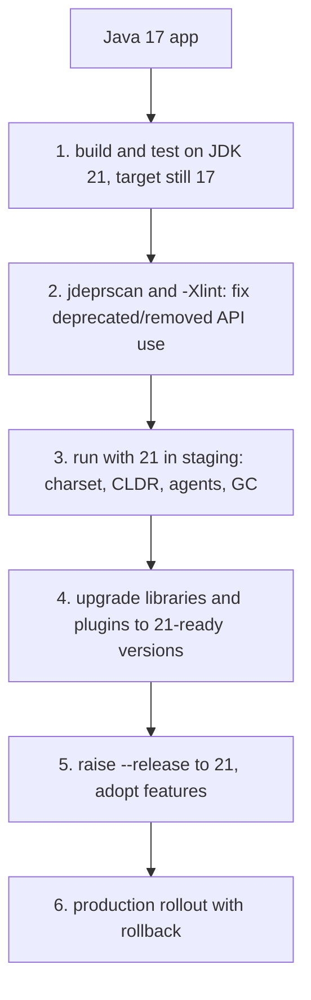

# 7.6 Migrating from Java 17 to 21

> **Goal:** Move a Java 17 application to 21 safely: what breaks (little), what warns, what to change in build and runtime settings, and which new features to adopt first.

**Level:** practical checklist. This is a much smaller jump than 8 to 11 or 11 to 17: **no module-system or encapsulation shock**, mostly library compatibility and behaviour defaults.
**Verified on:** OpenJDK 21.0.12. Outputs are real. Library versions mentioned are the first ones known to support the feature; check your own dependency tree.

## Contents

1. [The shape of the migration](#1-the-shape-of-the-migration)
2. [Step 1: run the existing build on 21](#2-step-1-run-the-existing-build-on-21)
3. [Step 2: find deprecated and removed API use](#3-step-2-find-deprecated-and-removed-api-use)
4. [Step 3: runtime behaviour differences](#4-step-3-runtime-behaviour-differences)
5. [Step 4: libraries, frameworks and tools](#5-step-4-libraries-frameworks-and-tools)
6. [Step 5: raise `--release` and adopt features](#6-step-5-raise---release-and-adopt-features)
7. [Rollout plan](#7-rollout-plan)
8. [Common gotchas](#8-common-gotchas)
9. [Interview questions](#9-interview-questions)

---

## 1. The shape of the migration



```text
 8 -> 11 : modules, removed Java EE/CORBA, illegal-access warnings    (big)
 11 -> 17: strong encapsulation, Security Manager deprecated, records (medium)
 17 -> 21: UTF-8 default, agents warning, library catch-up            (small)
```

Rule of thumb: **upgrade the runtime first, the language level second**. You can run Java 17 bytecode on JVM 21 immediately and get the performance and GC improvements without touching source.

## 2. Step 1: run the existing build on 21

Install JDK 21, keep `--release 17`, run the full test suite. Anything failing now is a runtime or tooling issue, not a language one.

| Build tool | Setting to change | Minimum version that works on 21 |
|---|---|---|
| Maven | `maven-compiler-plugin` ≥ 3.11, `<maven.compiler.release>17</maven.compiler.release>` first | Maven 3.9 recommended |
| Gradle | toolchain: `java { toolchain { languageVersion = JavaLanguageVersion.of(21) } }` | Gradle 8.5 supports running on 21 |
| JaCoCo, Surefire, Failsafe | newer versions needed to read class-file 65 | JaCoCo 0.8.11+ |
| IDE | update to a release that knows Java 21 | IntelliJ 2023.3+ and recent Eclipse |

Class files compiled by 21 have **major version 65**. A 17 JVM refuses them: `UnsupportedClassVersionError`. That is the reason to roll the *runtime* forward before shipping 21-compiled artifacts.

```text
$ ./p7/mig.sh
$ javac -Xlint:deprecation Old.java
Old.java:5: warning: [deprecation] exec(String) in Runtime has been deprecated
        Runtime.getRuntime().exec("echo hi");           // exec(String) deprecated in 18
                            ^
Old.java:6: warning: [deprecation] Locale(String,String) in Locale has been deprecated
        Locale l = new Locale("en", "US");               // constructor deprecated in 19
                   ^
Old.java:8: warning: [deprecation] getId() in Thread has been deprecated
        long id = t.getId();                             // deprecated in 19
                   ^
3 warnings

$ jdeprscan --release 21 --class-path out/old Old
class Old uses deprecated method java/lang/Runtime::exec(Ljava/lang/String;)Ljava/lang/Process; 
class Old uses deprecated method java/util/Locale::<init>(Ljava/lang/String;Ljava/lang/String;)V 
class Old uses deprecated method java/lang/Thread::getId()J 

$ javap -v Old.class | grep "major version"
  major version: 65
```

## 3. Step 2: find deprecated and removed API use

Two complementary tools:

| Tool | Looks at | Use when |
|---|---|---|
| `javac -Xlint:deprecation,removal` | your **source** | you can recompile |
| `jdeprscan --release 21` | compiled **bytecode** (including dependencies) | checking jars you do not build |

The run above shows both on a small class `Old`: `javac` flags three calls with line numbers, and `jdeprscan --release 21` reports the same three from the compiled class (`Runtime.exec(String)`, `Locale(String,String)`, `Thread.getId()`).

Typical replacements:

| Deprecated | Since | Replacement |
|---|---|---|
| `Runtime.exec(String)` | 18 | `exec(String[])` or `ProcessBuilder` |
| `new Locale(...)` | 19 | `Locale.of(...)` |
| `Thread.getId()` | 19 | `threadId()` |
| `Object.finalize()` | 18 for removal | `Cleaner`, try-with-resources |
| `System.setSecurityManager` | 18 throws | remove |
| `Thread.stop()` | 20 throws | `interrupt()` |

Fix `removal` warnings first; they are the ones that will become errors.

## 4. Step 3: runtime behaviour differences

These compile fine but behave differently:

| Behaviour | Since | What to check |
|---|---|---|
| UTF-8 default charset | 18 | files without explicit charset; legacy encodings (7.4) |
| CLDR 42 locale data | 20 | `AM/PM` has U+202F; date/number formats in tests and parsers (7.4) |
| Dynamic agent loading warning | 21 | Mockito inline, profilers (7.5) |
| `Thread.stop` throws | 20 | libraries that kill threads |
| Finalization | 18 | `--finalization=disabled` smoke test |
| `HashMap` etc. unchanged | | no action |
| Sequenced collection methods added | 21 | a custom `List`/`Deque` with its own `getFirst`/`reversed` may clash |
| Default GC | 21 | still G1 (unchanged); ZGC generational is opt-in |

Smoke test suggestion: run staging for a few days with `-Xlog:gc*`, `-XX:+HeapDumpOnOutOfMemoryError`, and `-Dfile.encoding=UTF-8` explicitly set so intent is clear.

## 5. Step 4: libraries, frameworks and tools

| Component | What matters for 21 |
|---|---|
| Spring Boot | 3.2+ officially supports 21 and offers `spring.threads.virtual.enabled=true` to run request handling on virtual threads; 3.1 runs on 21 but without that switch |
| Spring Framework | 6.1+ |
| Hibernate, Jackson, Netty | current versions run on 21; very old ones may fail on class-file 65 scanning |
| Mockito / ByteBuddy | recent versions; expect the self-attach warning, configure as `-javaagent` |
| Lombok | needs a release that supports javac 21 |
| Kotlin/Scala toolchains | need versions that can read Java 21 class files |
| JDBC drivers, connection pools | newer drivers avoid `synchronized` around I/O (virtual-thread friendly) |
| Docker base images | use a 21 JRE/JDK image (e.g. an `eclipse-temurin:21` style tag from your vendor) |

How to tell which dependency breaks: run the tests, read the first `UnsupportedClassVersionError`, `NoSuchMethodError`, or ASM "Unsupported class file major version 65" and upgrade that library.

## 6. Step 5: raise `--release` and adopt features

After the runtime is stable on 21, compile with `--release 21`. The compiler also becomes stricter in a few places. The same source file proves the language-level boundary:

```text
$ for r in 17 21; do ./p7/relcheck.sh $r; done
javac --release 17  PatternSwitch.java : fails (pattern switch and record patterns need 21)
javac --release 21  PatternSwitch.java : compiles
```

Adopt features in this order (cheapest and safest first):

| Order | Feature | Why first |
|---|---|---|
| 1 | `List.getFirst/getLast/reversed` | trivial, immediate readability |
| 2 | `switch` with patterns over your sealed types or `Object` | removes `instanceof` chains (7.1) |
| 3 | Record patterns | simplifies data extraction (7.1) |
| 4 | Virtual threads for blocking I/O services | biggest operational change; measure (7.3) |
| 5 | Generational ZGC | only if you already use or need low-latency GC (7.5) |

Features to leave alone on 21 (preview): string templates, unnamed patterns and variables, structured concurrency, scoped values. Using them requires `--enable-preview` and ties class files to the exact JDK version.

## 7. Rollout plan

| Phase | Action | Exit criterion |
|---|---|---|
| 1 | CI builds and tests on JDK 21 (target 17) | green build |
| 2 | Staging runs 21 with production-like traffic | no new errors; GC and latency comparable |
| 3 | Production canary (5-10%) | metrics equal or better |
| 4 | Full rollout | stable for a release cycle |
| 5 | Raise `--release 21`, adopt features | after rollback is no longer needed |

Keep the Java 17 image available for rollback until phase 5.

## 8. Common gotchas

| Gotcha | Fix |
|---|---|
| `UnsupportedClassVersionError` on the old JVM | deploy the new runtime before 21-compiled artifacts |
| Build tool plugin cannot read class-file 65 | upgrade plugin (JaCoCo, ASM-based) |
| Tests fail only on 20+ with time strings | U+202F in `AM/PM` (7.4) |
| Garbled text in files after upgrade | file was read with a legacy default charset before 18; read it with the right charset explicitly |
| Mockito prints agent warnings | configure `-javaagent` or `-XX:+EnableDynamicAgentLoading` |
| Virtual threads enabled and throughput drops | pinning in `synchronized`, or CPU-bound work (7.3) |
| Using preview features in production code | compile without `--enable-preview` |
| Custom class named `SequencedCollection` or method clashes | rename or qualify |

## 9. Interview questions

<details>
<summary><strong>Q1. What is the safest order to migrate from 17 to 21?</strong></summary>

Run the existing 17-targeted build on JDK 21 first, fix deprecations and library issues, deploy the 21 runtime, and only then raise <code>--release</code> to 21 and adopt new features.
</details>

<details>
<summary><strong>Q2. Why is 17 to 21 easier than 11 to 17?</strong></summary>

There is no new encapsulation shock or removed Java EE modules; changes are mostly default behaviours (charset, locale data), deprecations and library support.
</details>

<details>
<summary><strong>Q3. What is the class-file version of Java 21 and why does it matter?</strong></summary>

65. A 17 JVM cannot load it (<code>UnsupportedClassVersionError</code>) and some tools must be upgraded to read it.
</details>

<details>
<summary><strong>Q4. How do you find use of deprecated APIs in compiled jars?</strong></summary>

<code>jdeprscan --release 21</code>. For your own source use <code>javac -Xlint:deprecation,removal</code>.
</details>

<details>
<summary><strong>Q5. Which defaults changed between 17 and 21 that can alter behaviour without any code change?</strong></summary>

UTF-8 default charset (18) and CLDR 42 locale data (20), plus new warnings such as dynamic agent loading (21).
</details>

<details>
<summary><strong>Q6. How do you enable virtual threads in Spring Boot?</strong></summary>

Spring Boot 3.2+ on Java 21: <code>spring.threads.virtual.enabled=true</code>.
</details>

<details>
<summary><strong>Q7. Why might Mockito print a warning on 21?</strong></summary>

It attaches an agent to the running JVM; Java 21 warns about dynamic agent loading. Configure it as a startup <code>-javaagent</code>.
</details>

<details>
<summary><strong>Q8. Can you use virtual threads without changing <code>--release</code>?</strong></summary>

No: the API is in 21, so compile with <code>--release 21</code>. But you can run 17-targeted code on a 21 JVM and benefit from other runtime improvements.
</details>

<details>
<summary><strong>Q9. Why shouldn't you use preview features in production?</strong></summary>

They require <code>--enable-preview</code>, can change or be removed, and class files are bound to the exact JDK feature release.
</details>

<details>
<summary><strong>Q10. How can a new interface like <code>SequencedCollection</code> break existing code?</strong></summary>

A class implementing <code>List</code>/<code>Deque</code> that already defines <code>reversed()</code>, <code>getFirst()</code>, <code>addFirst</code> etc. with an incompatible signature or meaning can fail to compile or change behaviour.
</details>

<details>
<summary><strong>Q11. What would you check before enabling generational ZGC?</strong></summary>

That you need low-latency collection, then compare pause times, throughput and memory against G1 using your own load, since it is opt-in in 21.
</details>

---

[Previous: 7.5 JVM Changes 18 to 21](./05-jvm-changes-18-21.md) · Next: [Part 8: LTS Java 25](../08-lts-java-25/README.md)