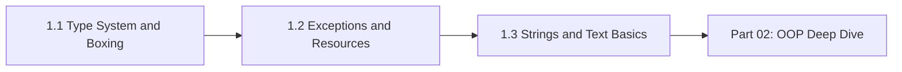

# Part 01: Core Refresher

> **Goal:** Tighten the fundamentals that senior interviews still probe: how numbers and wrappers really behave, how exceptions and `finally` work under the hood, and how `String`, Unicode and regex behave in practice.

**Audience:** 7 years of backend experience. Skim what you know; slow down at the gotchas tables and the interview questions.
**Verified on:** OpenJDK 21.0.12. Every code example was compiled and run; the `// ---- Output ----` comments are the real output.

## Chapters

| # | Chapter | What you will master |
|---|---|---|
| 1.1 | [Type System and Boxing](./01-type-system-and-boxing.md) | Primitive ranges, overflow, numeric promotion, floating point and `BigDecimal`, pass-by-value, the `Integer` cache, unboxing traps, overload resolution, `final` vs immutable |
| 1.2 | [Exceptions and Resources](./02-exceptions-and-resources.md) | Exception tables and `finally` in bytecode, checked vs unchecked, try-with-resources and suppressed exceptions, stack trace cost, helpful NPEs, `ExceptionInInitializerError`, interrupts, assertions |
| 1.3 | [Strings and Text Basics](./03-strings-and-text-basics.md) | Immutability, compact strings, the string pool, Unicode (code units, code points, graphemes), charsets, concatenation (`invokedynamic`), `StringBuilder`, regex and backtracking, formatting |

## Reading order



## How to run the examples

Each chapter shows complete classes. Save one as `<ClassName>.java` and run:

```bash
javac -d out PrimitiveLimits.java
java -cp out PrimitiveLimits
```

Some examples need a flag, which is shown above the output (for example `java -ea -cp out AssertDemo`). On Java 11 and newer you can also run a single file directly with `java PrimitiveLimits.java`.

## Checklist

- [ ] 1.1 Type System and Boxing
- [ ] 1.2 Exceptions and Resources
- [ ] 1.3 Strings and Text Basics
- [ ] Answered every interview question without opening the answers

## Cross references

- Equality contracts (`equals`/`hashCode`) in depth: `02-oop-deep-dive/A-foundations/05-object-contract-equals-hashcode-tostring-clone.md`
- Immutable class design: `02-oop-deep-dive/A-foundations/02-encapsulation-and-access-control.md`
- Records, sealed types, text blocks: `06-lts-java-17/`
- Memory visibility of `final` fields and interruption: `11-jmm-and-concurrency-core/`
- Locale, `Collator`, charsets: `15-io-nio-time-text/05-text-locale-and-charsets.md`

[Back to the repository README](../README.md) · Next: [1.1 Type System and Boxing](./01-type-system-and-boxing.md)